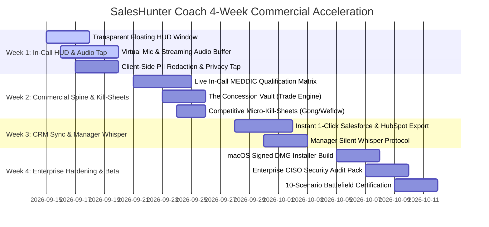

# SalesHunter Coach — Strategic Commercial Product Roadmap

## Vision
Transform SalesHunter Coach into an indispensable, enterprise-grade live in-call guidance and closing system for quota-carrying sales representatives. The product delivers **sub-second glanceable intelligence**, enforces **deal qualification discipline (MEDDIC)**, protects **commercial margins against procurement concessions**, and eliminates post-call admin friction via **instant zero-click CRM synthesis**.

---

## The 4 Golden Gates of Marcus "The Closer" Vance

Every feature on this roadmap is evaluated against four strict commercial criteria:
1. **Win Rate & Pipeline Progression**: Targets real deal-killing bottlenecks (economic buyer absence, budget freeze, competitor traps).
2. **Cognitive Latency (< 3s Glanceability)**: In-call HUD cues must be readable in peripheral vision in under 3 seconds without breaking eye contact. Maximum 25 words or 140 characters.
3. **Commercial Spine & Concession Defense**: Eliminates apologetic phrases and unreturned discounts. Enforces value-anchored trading.
4. **Dollar ROI (50x–100x)**: At $49–$99/seat/month, preventing one slipped $50,000 deal or 15% discount yields >50x ROI.

---

## Key Commercial Pillars & Moats

### Pillar 1: The "Concession Vault" (Discount Defense Engine)
- **Problem**: When a buyer asks for 20% off, reps freeze or cave because they don't know the company's approved trade-offs.
- **Solution**: The HUD flashes 3 instant, pre-negotiated trades within 1.5s:
  1. *Payment terms trade* (e.g. "Trade 5% for Net-15 terms + upfront annual commit").
  2. *Contract duration trade* (e.g. "Trade 10% for 24-month agreement").
  3. *Co-marketing trade* (e.g. "Trade 5% for quarterly joint webinar & logo rights").

### Pillar 2: Enterprise Local-First Privacy Architecture (CISO Fast-Track)
- **Problem**: Enterprise CISOs block tools that stream raw customer audio to cloud servers.
- **Solution**:
  - Zero-retention raw audio (in-memory sliding window buffer only).
  - Client-side PII & PCI-DSS token redaction before any inference API call.
  - Local macOS Keychain integration for all credential stores.
  - Complete SOC2 / HIPAA BAA enterprise compliance pack.

### Pillar 3: Real-Time Competitive Micro-Kill-Sheets (Displacing Gong & Weflow)
- **Problem**: "We already have Gong" or "We already use Weflow."
- **Solution**: Real-time acoustic trigger detection displaying instant kill-cards:
  - *Vs. Gong*: "Gong runs an autopsy on Friday after the deal died. SalesHunter Coach coaches you during the call while the deal is on the table."
  - *Vs. Weflow*: "Weflow speeds up manual typing. SalesHunter Coach eliminates typing while defending margin against procurement."

### Pillar 4: Manager "Silent Whisper / Shadow Mode"
- **Problem**: Sales managers cannot sit on 10 live calls at once.
- **Solution**: Silent call telemetry dashboard for managers to push 1-line guidance prompts directly onto a rep's HUD in real-time.

---

## 4-Week Milestone Breakdown

---

### Milestone 1 (Week 1): Sub-Second In-Call HUD & Privacy-First Audio Ingestion
- **Floating Click-Through HUD Overlay**:
  - Lightweight transparent Tauri window positioned adjacent to Zoom/Meet/Teams video.
  - Sub-100ms render latency; auto-collapses after 12 seconds of non-interaction.
  - Click-through toggle to ensure zero screen-sharing obstruction or window-focus capture.
- **Virtual Mic Audio Streaming Pipeline**:
  - System audio loopback (capturing both prospect audio and rep microphone) into streaming buffer.
  - Chunked streaming transcription with p95 latency < 800ms.
- **Client-Side PII & Audio Privacy Filter**:
  - Zero raw audio written to persistent disk.
  - Client-side redaction of SSNs, credit cards, and customer account numbers prior to LLM forwarding.

---

### Milestone 2 (Week 2): Commercial Spine & Competitive Micro-Kill-Sheets
- **Live In-Call MEDDIC Qualification Matrix**:
  - Tracks Metrics (M), Economic Buyer (E), Decision Criteria (Dc), Decision Process (Dp), Identified Pain (I), Champion (C).
  - Shows color-coded glanceable pills (Green = Confirmed, Yellow = Implied, Red = Missing).
- **The Concession Vault (Discount Defense Engine)**:
  - Detects prospect discount pressure (e.g., *"Can you give us 20% off?"*).
  - Displays instant trade-off matrix: Net-15 terms, multi-year commit, co-marketing logo rights.
- **Competitive Micro-Kill-Sheets**:
  - 3-second glanceable cards triggered on competitor mentions (Gong, Clari, Weflow, Outreach).

---

### Milestone 3 (Week 3): Frictionless CRM Sync & Manager Silent Whisper
- **Zero-Click Instant CRM Payload Generator**:
  - Structures call transcript, MEDDIC criteria, objection responses, and next steps into validated Salesforce & HubSpot API payloads.
- **Manager Silent Whisper Mode**:
  - Real-time coaching bridge allowing sales leaders to inject 1-line guidance directly onto the rep's HUD without joining the call.
- **Deal Health & Momentum Scorecard**:
  - Evaluates Initial vs. Final deal health score (0–100%).
  - Categorizes deal velocity: `ACCELERATING`, `STABLE`, `AT_RISK`, or `DEAD_IN_WATER`.

---

### Milestone 4 (Week 4): Enterprise Hardening, CISO Pack & Beta Launch
- **macOS Production Release Packaging**:
  - Signed and notarized DMG installer.
  - Automatic permissions wizard (Accessibility, Microphone, System Audio).
- **Enterprise CISO Readiness Pack**:
  - SOC2 Type II / HIPAA BAA documentation and local-first architecture whitepaper.
- **Automated Proving Ground Regression Suite**:
  - Continuous execution across all 10 battle scenarios.
  - Requirement: P95 latency < 2000ms, zero unhandled errors, 100% Closer certification.
