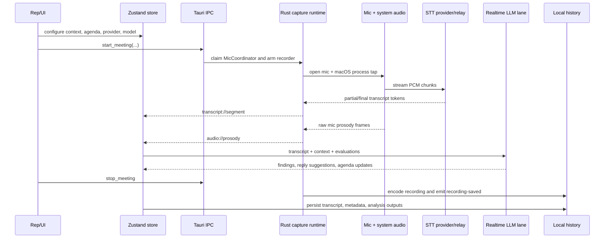
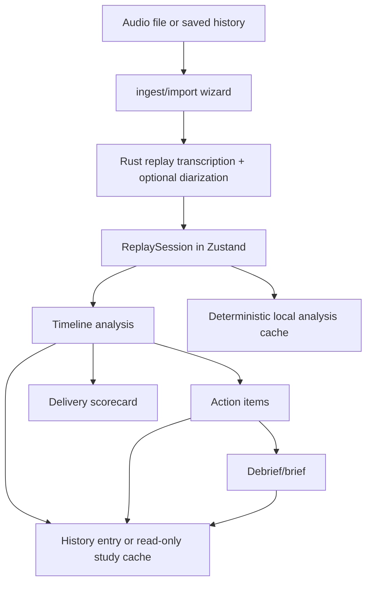
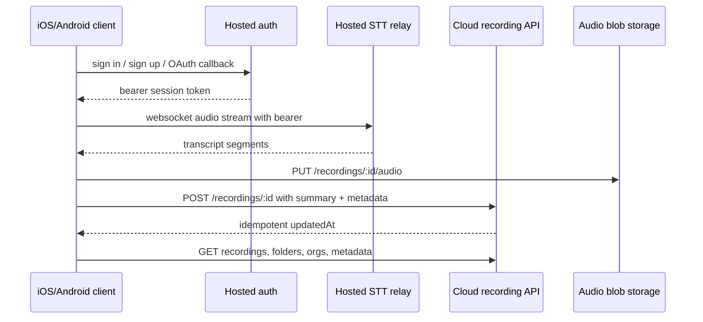
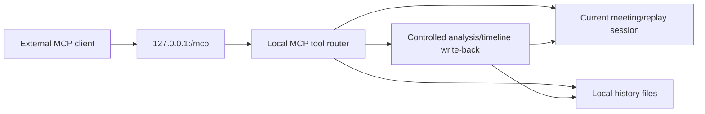

# SalesHunter Coach — Data Flow

## Live meeting flow

The meeting coordinator prevents concurrent mic ownership across meeting capture, mic test, and voice typing. A diarizing provider receives one mic/system mix; non-diarizing providers use separate `me`/`them` sessions so the UI can preserve deterministic speaker labels. Pause holds capture/STT open but drops chunks, so paused time is not transcribed, recorded, or billed.

## Replay and study flow

Replay uses the deep model lane and honors the trim keep-window. A loaded personal recording restores saved artifacts without automatically charging for a rerun; a newly imported recording runs the staged pipeline when auto-analysis and a deep provider key are available. Read-only organization recordings write derived study outputs to a local cache rather than mutating the shared source.

## Mobile/cloud flow

The audio-before-summary ordering is deliberate: a summary claiming `hasAudio` must not be visible before its blob exists. The mobile clients mirror this contract; the desktop cloud adapter also performs best-effort background sync and preserves local operation when cloud is unavailable.

## Local MCP flow

The MCP surface includes current state, transcript, findings, todos, folders, recording listing/search, and recording read/write operations. External analysis is labeled with an author and is kept distinguishable from Coach's own findings.

## Core entities

| Entity | Shape/owner | Lifecycle |
| --- | --- | --- |
| `TranscriptSegment` | `id`, source (`me`/`them`/`mix`), speaker, text, final flag, start/end ms; shared TypeScript/Rust event contract | partial → final; upserted by ID |
| `ReplaySession` | audio path, duration, transcript, metadata; frontend replay state | imported/loaded → trimmed/viewed → persisted |
| `TimelineEvent` | time anchor, side, severity, title/detail, evidence, optional resolution/author | generated by evaluation/MCP → selected/replayed → saved |
| `TodoItem` | pre-call agenda text plus completion state | template/manual → auto/manual completion |
| `ActionItem` | post-call next step, rationale, linked finding/time | generated after findings → toggled → saved |
| `HistoryEntry` | metadata + transcript + analysis references; native directory-backed | recording saved → analysis overwritten/renamed/moved/deleted |
| `Settings` | provider keys, realtime/deep lanes, evaluations, templates, permissions/preferences | onboarding → persisted and synchronized across app windows |

## Persistence map

- Native audio and history: `<app_data_dir>/history/<id>/`, with an Ogg/Opus recording and JSON/transcript artifacts owned by `src-tauri/src/history.rs`.
- Frontend settings: Zustand persist key `saleshunter-coach-settings` in webview localStorage.
- Frontend folders: localStorage plus a native file registry; cloud state wins when signed in.
- Analysis/study/speaker caches: localStorage namespaces, cleared by the native Diagnostics cache event.
- Cloud: hosted session, metadata, audio blobs, personal folders, and organization recordings; implementation is external to this checkout.

## Error and authorization boundaries

- Missing/invalid STT or LLM credentials should stop the relevant stage with an actionable UI error; no provider key is inferred from another workload lane.
- Native capture failures emit meeting errors and release the mic claim so the app cannot remain stuck in recording state.
- Cloud `401` means the session is stale and may require sign-out; `403` is resource-level and must not silently erase local auth.
- Account deletion and organization ownership changes are irreversible or intentionally refused by the cloud contract; keep those flows explicit and user-confirmed.
