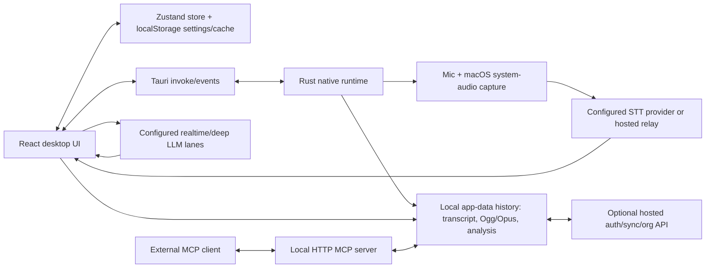

# SalesHunter Coach — System Context

_Status verified 2026-09-13/14 from the `main` checkout at version 0.23.1._

## Product and scope

SalesHunter Coach is a local-first real-time sales-call copilot. It captures a rep's microphone and meeting/system audio, streams speech to a configured STT provider, and surfaces transcript-aware coaching while the call is still in progress. After a call it produces a replay, findings, action items, delivery scorecard, and debrief. Recordings are organized into customer folders and can be exposed to an external AI through a local MCP server.

The checkout contains three client families:

| Surface | Primary technology | Responsibility |
| --- | --- | --- |
| macOS desktop | React/Vite + Tauri 2 + Rust | Live system-audio capture, local recording/history, live/replay UI, BYOK AI, MCP |
| iOS | SwiftUI + `ios/CoachKit` | Mobile capture/dictation, cloud auth/upload, transcript UI, voice keyboard |
| Android | Kotlin/Compose + `android/coachkit` | Mobile capture/import, cloud auth/upload, transcript UI, recording detail |

The cloud backend is not in this repository. Desktop cloud-sync code and the iOS/Android clients target a hosted service documented in `docs/cloud-backend-contract.md` and the mobile API docs.

## Repository map

- `src/` — desktop React application, Zustand state, AI prompts/runners, local history and cloud adapters.
- `src-tauri/src/` — native capture, audio mixing/resampling/prosody, transcription adapters, Opus recording, replay transcription, diarization, permissions, voice typing, MCP, and Tauri commands.
- `src-tauri/tauri.conf*.json` — desktop packaging, permissions, bundled ONNX runtime and virtual microphone resources.
- `ios/App/` and `ios/CoachKit/` — iOS shell and reusable audio/STT/cloud primitives.
- `ios/Keyboard/` — system voice-typing keyboard extension.
- `android/app/` and `android/coachkit/` — Android shell and reusable Kotlin STT/audio primitives.
- `virtual-mic/` — macOS Core Audio virtual microphone driver and installer tooling.
- `website/` — static marketing assets/site content.
- `.github/workflows/` — macOS, iOS, Android, and website delivery pipelines.
- `docs/` — product, cloud contract, design, testing, and this architecture documentation.

## Runtime architecture

## Main entry points

- Frontend bootstrap and lifecycle wiring: `src/App.tsx`.
- Shared client state and meeting/replay lifecycle: `src/lib/store.ts`.
- Native application bootstrap and registered commands: `src-tauri/src/lib.rs`.
- Meeting capture/recording/transcription orchestration: `src-tauri/src/commands.rs` and `src-tauri/src/capture.rs`.
- Provider adapters: `src-tauri/src/transcription/`.
- Local history persistence: `src-tauri/src/history.rs` plus `src/lib/history/history.ts`.
- Replay file transcription and audio metrics: `src-tauri/src/replay.rs`.
- Live/deep analysis scheduling: `src/lib/analysis/engine.ts` and `src/lib/analysis/studyPipeline.ts`.
- Local MCP protocol server and tools: `src-tauri/src/mcp.rs`.

## Verified product behaviors

1. A meeting claims one coordinated microphone resource. On macOS, mic and system audio are captured independently; diarizing STT providers are fed one mixed stream while prosody measures the user's raw mic stream.
2. Transcript segments are incremental: partial segments are updated by ID until final. Events cross the Rust/React boundary as Tauri events such as `transcript://segment` and `audio://prosody`.
3. Realtime work uses the `realtime` provider/model lane; replay/report work uses the `deep` lane. The analysis pipeline chains findings → action items/delivery → brief and caches deterministic replay analysis locally.
4. Finished sessions persist under the Tauri app-data `history/<id>/` directory. Settings, folders, analysis cache, and study cache use localStorage-backed client stores; history files remain the durable recording store.
5. The local MCP server provides read/search access to recordings and controlled write-back of analysis/timeline data. Its responses label Coach's prior analysis as context rather than ground truth.
6. Optional cloud mode synchronizes user auth, recordings, audio blobs, folders, and organization shares. The local OSS build disables cloud mode through build-time configuration.

## Constraints and risks

- Desktop live capture is macOS-specific because it uses a Core Audio process tap and macOS privacy permissions.
- Audio and transcript content is sensitive. BYOK/local mode is the default product posture; cloud mode adds hosted auth and storage semantics that must remain explicit.
- Mobile clients are not thin desktop ports: they use a hosted STT relay and cloud recording sync, while deep analysis remains primarily a desktop concern.
- The repository does not include the cloud backend implementation, so server behavior must be validated against the documented contract and deployed service separately.
- Cargo verification on this machine is currently blocked by an older Cargo that cannot parse the checked-in lockfile v4; CI uses a current Rust toolchain.
