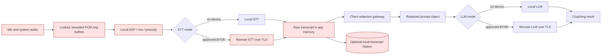

# Enterprise local-first privacy architecture

Document owner: Chief Information Security & Privacy Officer  
Control owners: Desktop Engineering, Platform Engineering, Security  
Version: 1.0 (2026-09-14)  
Review cadence: quarterly; also on any audio, transcription, AI, sync, logging,
MCP, authentication, or persistence change  
Status: normative target specification; current gaps are listed in §12

## 1. Purpose and scope

This specification defines the Enterprise Local profile for the macOS desktop
application. It makes four promises testable:

1. raw audio exists only in bounded, volatile processing windows and is never
   persisted;
2. sensitive text is redacted on the customer device before any LLM request;
3. credentials persist only in the macOS Keychain or an approved enterprise
   vault; and
4. every release has evidence that these boundaries still hold.

The profile covers microphone and system-audio capture, live and replay
transcription, LLM coaching, local history, diagnostic logging, local MCP, and
optional cloud egress. Mobile clients and the hosted cloud backend require their
own assessment and must not inherit this profile's claims.

“Local-first” does not mean “no network.” In BYOK mode, selected speech-to-text
(STT) providers receive audio and selected LLM providers receive redacted text.
The product must disclose each destination before capture starts. A fully local
deployment requires both an on-device STT engine and an on-device LLM.

## 2. Security objectives and non-objectives

### Mandatory invariants

- **AUDIO-01 — no raw audio persistence.** PCM, waveform samples, device buffers,
  and uncompressed derivatives must never be written to app storage, temporary
  files, caches, logs, crash attachments, cloud object stores, or analytics.
- **AUDIO-02 — bounded lifetime.** Raw samples may exist only in fixed-capacity
  native memory windows needed for capture, mixing, prosody, and outbound STT.
  Consumed slots are overwritten immediately; stop, cancel, error, sleep, and
  process teardown zero every remaining slot.
- **PII-01 — pre-LLM redaction.** No dynamic user/customer content may reach an
  LLM transport until the client-side redaction gateway has processed it.
- **PII-02 — fail closed.** An unavailable, failed, or bypassed redactor blocks
  remote LLM dispatch. It must never fall back to sending unredacted content.
- **KEY-01 — vault-only persistence.** API keys, CRM OAuth refresh/access tokens,
  hosted session tokens, and webhook secrets persist only in Keychain or an
  approved managed vault. They never enter localStorage, ordinary configuration,
  command history, source control, logs, or crash reports.
- **LOG-01 — content-free telemetry.** Logs and metrics may contain event names,
  coarse counts, durations, provider IDs, status classes, and random request IDs;
  never audio, transcript excerpts, prompts, questions, customer identifiers,
  authorization headers, or credentials.
- **NET-01 — declared egress only.** The enterprise build permits only the
  customer-approved STT/LLM destinations and optional managed update endpoint.
  Cloud sync, organization sharing, and hosted relays are disabled unless the
  enterprise administrator explicitly enables and contracts for them.

### Deliberate exclusions

- Client-side text redaction cannot protect audio already sent to a remote STT
  provider. Customers needing that boundary must select on-device STT or contract
  with an approved STT subprocessor.
- Redaction reduces exposure; it is not a substitute for data minimization,
  provider zero-retention terms, access control, or participant consent.
- The profile does not claim SOC 2 certification or HIPAA compliance merely by
  implementing these controls.

## 3. Data classification

| Class | Examples | Default handling |
| --- | --- | --- |
| Restricted | raw audio, transcript, meeting context, user question, CRM tokens, API keys, PAN, SSN, PHI | memory-only unless an explicitly documented text record is saved; encrypted transport; least privilege |
| Confidential | redacted transcript, findings, action items, meeting title, participant aliases | local storage by default; tenant-controlled retention and deletion |
| Internal | provider/model name, coarse usage counts, feature flags, pseudonymous event IDs | metadata-only logs; no content joins |
| Public | product documentation, signed release metadata | integrity protected |

Raw audio is Restricted even when silent, compressed, or apparently
de-identified. A redacted transcript remains Confidential because conversational
context can re-identify people.

## 4. Required data flow and trust boundaries



Trust boundaries:

1. **OS/device:** macOS permissions, process memory, Keychain, FileVault, and
   signed application boundary.
2. **Webview/native IPC:** all commands are allowlisted and typed. Secrets and
   raw audio should remain native where technically possible.
3. **STT egress:** remote STT receives audio; TLS and an approved processor
   agreement are mandatory. Provider retention/training must be disabled.
4. **Redaction gateway:** the sole dynamic-content route into any LLM adapter.
5. **LLM egress:** only the redacted prompt leaves the device.
6. **Local MCP:** loopback is not an authentication control. Enterprise mode
   requires a per-install Keychain-backed bearer token, origin/host validation,
   least-privilege tool scopes, and disabled-by-default startup.
7. **Optional cloud:** a separate, opt-in processing boundary. It is outside the
   Enterprise Local profile unless explicitly approved.

## 5. Zero raw audio retention design

### 5.1 Capture and processing

- Use preallocated, fixed-capacity ring buffers in the native Rust process. The
  maximum capacity is derived from sample rate, channel count, and a documented
  window no longer than 10 seconds per source. Unbounded `Vec` accumulation is
  prohibited.
- Capture callbacks write directly into the ring. Mixing, metering, prosody, and
  STT consumers read by reference and acknowledge consumption. A slot is
  overwritten with zeros immediately after the final consumer acknowledges it.
- Backpressure may drop the oldest unconsumed window with a visible quality
  warning; it must not spill to disk or grow memory without bound.
- Memory pages holding raw samples must be locked against paging (`mlock` or the
  supported macOS equivalent). Enterprise capture fails closed if the lock
  cannot be established. Core dumps/minidumps containing process memory are
  disabled for production builds.
- Pause stops forwarding and zeroes queued audio. Stop/cancel/error/device loss
  closes streams, zeroes all buffers, releases memory locks, and invalidates
  references before emitting completion.
- Audio content, sample arrays, encoded chunks, and provider frames are forbidden
  in debug formatting, panic payloads, tracing spans, and support bundles.

### 5.2 Recording policy

Enterprise Local mode sets `recordingRetention = disabled` and removes the
recording tee from the capture graph. It must not encode an Ogg file, create a
temporary recording, upload an audio object, or expose “save audio.”

If a customer separately enables retained recordings, that is a distinct
**Managed Recording profile**, not zero-retention. It requires explicit admin
policy, per-meeting participant notice, encryption at rest, a retention period,
deletion propagation, access audit, and approved cloud/local storage. Product
copy must never describe that profile as zero audio retention.

### 5.3 Verification

- Unit tests prove fixed capacity, overwrite-after-read, pause/stop/error
  zeroization, and no growth with a multi-hour synthetic stream.
- Integration tests monitor app-data, cache, temporary, log, and crash-report
  paths while capture runs and stops; no audio-like file or raw sample marker may
  appear.
- A network fixture confirms audio is sent only to the selected STT destination.
- Release evidence records source inspection of every filesystem write reachable
  from live capture and an OS-level file activity trace for start → pause → stop →
  cancel → crash-recovery scenarios.

## 6. Client-side PII and PCI redaction

### 6.1 Chokepoint API

Every LLM call must accept a typed `SensitivePromptInput`, then call one shared
gateway immediately before provider serialization:

```ts
type SensitivePromptInput = {
  transcript?: string;
  meetingContext?: string;
  userQuestion?: string;
  participantNames?: string[];
  crmFields?: Record<string, string>;
  evaluationText?: string;
  agendaText?: string;
};

type RedactionResult = {
  safe: Record<string, string>;
  counts: Record<"phone" | "pan" | "ssn" | "customer_id", number>;
  policyVersion: string;
};
```

Provider adapters must not accept raw strings from feature code. The gateway
returns a branded/opaque redacted type; only that type is serializable by the
transport. This makes bypass a compile-time and testable violation.

The redactor covers transcript text, participant names, free-form meeting
context, questions, CRM fields, user-defined evaluations, agenda items, and any
retrieved history included in a prompt. Static product system prompts may bypass
only when they contain no customer-controlled interpolation.

### 6.2 Detection policy

Detection runs locally and deterministically in this order:

| Type | Detection and validation | Replacement |
| --- | --- | --- |
| Payment card (PAN) | 13–19 digits allowing spaces/hyphens; strip separators; require Luhn pass; reject uniform/repeated test noise unless on the approved test list | `<CARD_1>` |
| US SSN | `AAA-GG-SSSS` and space-separated forms; reject invalid groups (`000`, `666`, `900–999`, `00`, `0000`) | `<SSN_1>` |
| Phone | E.164 and locale-aware 7–15 digit candidates with common separators; reject timestamps, currency, IPs, and short unlabelled numeric IDs | `<PHONE_1>` |
| Sensitive customer ID | administrator-provided named regexes with bounded length and safe-regex validation; optionally exact values imported from CRM metadata | `<CUSTOMER_ID_1>` |

Tokens are type-specific and stable only within one processing session so model
reasoning can correlate repeated references. The token map stays in memory,
never leaves the device, and is zeroized with the session. PAN and SSN values are
never partially preserved, including “last four,” under the default policy.

Matching must normalize Unicode digits and common spoken/separated forms before
validation. The implementation must cap input length and pattern execution time;
customer regexes that are ambiguous or susceptible to catastrophic backtracking
are rejected at configuration time.

### 6.3 Streaming and boundary safety

- Prefer redacting the complete prompt just in time; never build or log an
  unredacted serialized request body.
- For incremental paths, retain a 64-character in-memory look-behind and delay
  emission until a token boundary is safe. Re-scan the joined tail and new chunk
  so a card or SSN split across transcript segments cannot evade detection.
- Partial and final transcript revisions use the same session token map. A
  corrected segment replaces the prior redacted segment; raw revisions are not
  cached in diagnostics.
- If the gateway cannot determine a safe boundary, it withholds the tail rather
  than releasing it.

### 6.4 Redaction evidence and UX

- Metrics report only type counts and policy version. They never contain match
  values, surrounding text, offsets tied to stored transcripts, or reversible
  hashes.
- The UI indicates that sensitive fields were removed before AI processing and
  exposes aggregate counts. It must not reveal secrets in a debug panel.
- False positives may reduce coaching quality; false negatives expose data. The
  default policy therefore favors protection, with administrator-controlled
  exceptions rather than per-user bypass.
- The test corpus includes formatted/unformatted PANs, invalid Luhn numbers,
  international phones, SSN invalid groups, Unicode digits, adversarial
  separators, segment-boundary splits, and prose containing dates/times/order
  numbers that must not be over-redacted.

## 7. Credential and token storage

### 7.1 Required Keychain properties

- One service namespace per release channel and tenant; one account entry per
  provider/credential type. Do not concatenate the secret into identifiers.
- Use a non-synchronizing, this-device-only Keychain accessibility class,
  available only after first unlock. Enterprise policy may require user presence
  for especially privileged CRM refresh tokens.
- Application access is restricted to the signed SalesHunter Coach binary and
  explicitly approved helper. No broad access group.
- Empty values delete the Keychain item. Sign-out revokes remote tokens where
  supported, then deletes local access and refresh tokens.
- Secrets are retrieved only when a request is dispatched, held for the shortest
  possible time, and never included in Redux/Zustand persistence, IPC logs,
  analytics, URLs, error strings, or support bundles.

The current desktop implementation already allowlists provider keys in
`src-tauri/src/secure_store.rs`, persists them through the `keyring` crate, and
removes those keys from Zustand persistence in `src/lib/store.ts`. The enterprise
gate additionally requires hosted session tokens and future Salesforce/HubSpot
tokens to use the same boundary. Long term, provider requests should move behind
native commands so plaintext credentials do not need to enter the webview.

### 7.2 Rotation and failure behavior

- A rejected credential produces a content-free error and requests replacement;
  it is never echoed.
- Rotation writes the new item before invalidating the old one when provider
  semantics permit, then verifies the new credential with a metadata-only call.
- Keychain unavailable/locked means the dependent feature is unavailable. No
  plaintext fallback is allowed.

## 8. Local persistence, logging, and deletion

- Transcript persistence is optional and disabled by enterprise policy unless a
  documented business need and retention period exist. Saved transcripts and AI
  outputs use OS data protection and rely on enforced FileVault; higher-risk
  deployments add application-level envelope encryption with an MDM-managed key.
- Derived embeddings, caches, clipboard copies, exported files, MCP session
  snapshots, and diagnostic bundles inherit the source classification and
  retention. “Derived” does not mean anonymous.
- Delete removes the local record, indexes, caches, token maps, sync tombstones,
  and approved cloud copies. Backups expire under the contracted backup schedule.
- Log rotation is size/time bounded. Support export runs an automated secret and
  content scanner and requires explicit user action.
- Filenames and log messages use random IDs, not customer, meeting, or participant
  names.

## 9. Network and provider controls

- TLS 1.2+ with certificate validation is mandatory; TLS 1.3 is preferred.
- Enterprise policy uses an allowlist of exact hosts by workload. Redirects to a
  different host, cleartext URLs, arbitrary OpenAI-compatible base URLs, and
  proxy environment variables fail closed unless administratively approved.
- Provider contracts must disable training and human review of customer content,
  define retention, incident notification, deletion, subprocessors, and data
  location. HIPAA workloads require a BAA with every processor receiving PHI.
- Requests carry the minimum transcript window and context required for the
  feature. Deep/replay analysis of an entire transcript requires explicit policy.
- Cloud sync and organization sharing are visibly separate from AI processing;
  enabling one must not implicitly enable the other.

## 10. Threat model

| Threat | Primary controls | Residual risk |
| --- | --- | --- |
| Lost or stolen Mac | FileVault, Keychain, screen lock, MDM, local retention limits | data exposed in an unlocked session |
| Malicious local process | sandbox/hardened runtime, Keychain ACL, authenticated MCP, no temp audio | same-user accessibility or endpoint compromise |
| Prompt path bypasses redaction | opaque redacted type, one transport gateway, egress tests, fail closed | novel identifier formats |
| Provider retains/trains on content | approved providers, zero-retention settings, contract/DPA/BAA | provider control failure |
| Audio recovered from disk/swap/crash | no recording tee, locked/zeroized buffers, disabled dumps, file trace | hardware/OS compromise |
| Secrets leak through config/logs | Keychain only, redacted errors, repository/support-bundle scanners | compromised process memory |
| Local MCP exfiltrates history | disabled by default, token auth, scope/consent, loopback + Host checks | authorized client misuse |
| Cloud feature silently expands scope | enterprise build flag, admin policy, deny-by-default egress | misconfigured custom build |
| Supply-chain compromise | pinned locks, signed/notarized releases, dependency review, SBOM/provenance | trusted dependency compromise |

## 11. Release security gate

Security approval is required for every enterprise release. A build fails the
gate if any mandatory item lacks evidence:

- [ ] Enterprise policy disables recording, temp audio, audio export, audio
      upload, cloud sync, and org sharing by default.
- [ ] Capture uses fixed-capacity, locked memory; lifecycle zeroization and
      multi-hour bounded-memory tests pass.
- [ ] File-activity test proves no raw or encoded meeting audio is created.
- [ ] Every LLM call consumes only the opaque redacted prompt type; a negative
      egress test blocks an injected canary PAN, SSN, phone, and customer ID.
- [ ] Redaction corpus, boundary tests, fuzz/property tests, and failure-path
      tests pass under the versioned policy.
- [ ] All credentials/session/CRM tokens are absent from localStorage, config,
      logs, crash/support artifacts, and repository scans; Keychain tests pass.
- [ ] MCP is disabled by default or authenticated and scoped; unauthorized tool
      calls fail.
- [ ] CSP and Tauri capability allowlists are restrictive; wildcard asset access
      and unnecessary commands are removed.
- [ ] Network capture matches the declared destination allowlist and contains no
      restricted canaries outside the approved STT path.
- [ ] SBOM, dependency/vulnerability scan, secret scan, signed/notarized binary,
      provenance, test report, and rollback instructions are archived.
- [ ] Privacy notice, subprocessor register, retention schedule, and product copy
      match the build behavior.

The approving CISO records build hash, policy version, evidence links,
exceptions, owners, expiry dates, and decision. A critical exception cannot be
accepted without Co-CEO approval and a time-bounded remediation issue.

## 12. Current-state gap register (2026-09-14)

This section prevents target controls from being misrepresented as shipped.

| Area | Repository evidence | Gate |
| --- | --- | --- |
| Raw audio | `src-tauri/src/capture.rs` defines `RecorderBuf = Arc<Mutex<Option<Vec<i16>>>>` and appends every meeting chunk; `src-tauri/src/commands.rs` encodes it to a temp Ogg on stop | **Fail:** replace with bounded non-recording pipeline for Enterprise Local |
| Persistent recordings | `src-tauri/src/history.rs` stores `audio.ogg`; cloud sync can upload audio | **Fail:** enterprise policy/build must make these paths unreachable |
| LLM redaction | AI modules interpolate transcript, context, questions, agenda, and evaluations directly into prompts | **Fail:** implement the shared redaction gateway before provider serialization |
| Keychain | `src-tauri/src/secure_store.rs` allowlists provider credentials and `src/lib/store.ts` removes those keys from persisted settings; however, `cloudAuth` (including its bearer token) is included in the persisted Zustand state | **Partial pass:** migrate hosted/CRM tokens to Keychain and test accessibility/ACL attributes |
| Logging | `src/lib/log.ts` prohibits content and most call sites log metadata, but call sites still log email, organization name, imported filename/path, and provider error text | **Fail:** remove identifying/content-bearing fields and add automated content-canary/support-bundle tests |
| Local MCP | `src-tauri/src/mcp.rs` binds loopback and exposes transcript/history tools | **Fail pending proof:** add authentication, scopes, origin/Host checks, and default-off policy |
| Webview hardening | `src-tauri/tauri.conf.json` has `csp: null` and asset protocol scope `**` | **Fail:** define CSP and narrow filesystem scope |
| Cloud boundary | release builds include a BYOK build with `VITE_COACH_CLOUD=false`, but other editions can sync audio/transcripts | **Partial pass:** enterprise SKU must be immutable/attested and claims edition-specific |

Until all Fail items pass, external materials may say “enterprise privacy
architecture defined” and “provider secrets use macOS Keychain,” but must not say
the product currently guarantees zero audio retention or pre-LLM PII/PCI
redaction.

## 13. Change control

Any new data source, provider, prompt field, persistence path, logging field, MCP
tool, cloud endpoint, or credential type requires:

1. an updated data-flow diagram and classification;
2. threat-model review;
3. redaction and retention decision;
4. automated negative tests;
5. privacy notice/subprocessor review; and
6. CISO release-gate approval.

Emergency exceptions are documented with scope, compensating controls, owner,
expiry, and customer impact. Expired exceptions block release.
